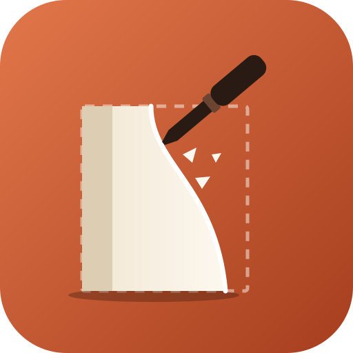

<p align="center">
  
</p>

<h1 align="center">sculpt</h1>

<p align="center">
  <em>Claude resculpts your Claude Code setup from your own session history.</em>
</p>

<p align="center">
  
  
  
</p>

---

A [Claude Code](https://claude.com/claude-code) plugin that reads your past sessions and tells you where your setup is slowing you down: what breaks, what you never use, what's missing. You get a ranked report with exact diffs, and nothing changes until you approve it.

## Install

```text
/plugin marketplace add XyndoX/sculpt
/plugin install sculpt@sculpt
```

Or from a terminal: `claude plugin marketplace add XyndoX/sculpt && claude plugin install sculpt@sculpt`.

Then run `/sculpt`.

## What you get

Run `/sculpt` and Claude reads the last 30 days of your sessions, then tells you:

- **where the bottleneck is**: recurring tool errors, permission denials, retry loops, compactions, and the moments you had to correct it;
- **what's dead weight**: enabled plugins, skills, agents and MCP servers you never touched, each one costing context on every turn;
- **what's missing**: the hook, skill, subagent or workflow that would have removed a recurring pain, checked first against what you already have installed and what already exists;
- **how to steer better**: three habits from your own prompts, each with a before and after.

You get a ranked report with exact diffs. Nothing changes until you approve a proposal. The next run scores the last one's proposals: applied or not, and whether the numbers moved.

## Use

```text
/sculpt                      # last 30 days
/sculpt 90                   # a longer window
/sculpt 30 focus on hooks    # narrow the review
```

Reports are saved to `~/.claude/sculpt/reports/<date>.md`.

## How it works

1. `skills/sculpt/scripts/mine.py` walks `~/.claude/projects/*/*.jsonl` and your installed surface, and writes one JSON digest. Python stdlib only, read-only, a few seconds for a month of history.
2. Claude reads the digest, opens the transcripts behind the worst signals to find root causes, and sizes each fix with [`references/levers.md`](skills/sculpt/references/levers.md): remove > memory line > allowlist > hook > skill > subagent > workflow.
3. It writes the report and applies only what you approve, one proposal at a time, each verified.

## Privacy

Nothing is uploaded beyond your normal Claude Code session. The digest contains your own prompts, so it goes to a temp file and the report to `~/.claude/sculpt/`; neither is ever written into a repo. The analysis runs in your normal Claude Code session, so the digest is read by the model like any other context.

## Test

```sh
python3 -I skills/sculpt/scripts/test_mine.py
```

## License

MIT
